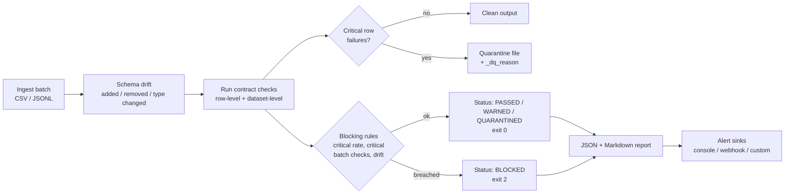

# data-quality-guard

[](https://github.com/s78519300-creator/data-quality-guard/actions/workflows/ci.yml)
[](https://www.python.org/)
[](LICENSE)
[](pyproject.toml)

**A lightweight data-quality gate for ETL pipelines.** Describe what good data looks
like in a JSON contract, point `dqguard` at a CSV or JSONL batch, and get back three
things: the rows that are safe to load, the rows that are not (each one tagged with
the reason), and a report that says whether the batch should ship at all.

```bash
dqguard validate --data examples/orders.csv --contract examples/orders_contract.json --out out/
```

No server, no database, no third-party packages. It runs anywhere Python 3.9+ runs:
an Airflow worker, a GitHub Actions runner, a Lambda, or your laptop.

---

## Why this exists

Most data incidents I have dealt with were not exotic. An upstream team renamed a
column. A currency field started arriving as `"XYZ"`. A retry job re-sent yesterday's
file and doubled the revenue dashboard. A `quantity` of `"two"` broke a cast in a
ClickHouse `INSERT ... SELECT` at 3 a.m.

The heavyweight data-quality platforms catch these, but they bring a lot of setup
with them. Hand-written `assert` scripts are quick to start but turn into a pile of
one-off logic nobody wants to own. data-quality-guard sits in between:

- **Contracts live next to the pipeline code**, so they get reviewed in pull requests.
- **Bad rows are quarantined, not dropped.** The good 95% of a batch can still load
  while the bad 5% waits in a file with a `_dq_reason` column for someone to inspect.
- **A batch is blocked only when it should be**: too many critical failures, a
  dataset-level failure such as a row count of zero, or a schema change the contract
  marks as critical.
- **Exit codes are made for orchestrators.** `0` means load, `2` means stop.

## Features

| Area | What you get |
|---|---|
| Declarative checks | `not_null`, `unique`, `in_range`, `allowed_values`, `regex`, `type`, `referential`, `freshness`, `row_count` |
| Schema drift | Detects **added**, **removed** and **type-changed** columns against an expected schema, with severity per kind |
| Severity levels | `info` (report only), `warn` (report + alert), `critical` (quarantine rows / block batch) |
| Quarantine | Clean rows and quarantined rows written to separate files; every quarantined row lists the checks it failed |
| Blocking | `max_critical_rate` threshold, critical dataset-level checks and critical drift all block the batch |
| Alerting | Console alerts out of the box, `WebhookSink` for generic JSON or Slack-style payloads, and a small `AlertSink` base class for your own |
| Reports | `<name>_report.json` for machines and `<name>_report.md` for humans, PR comments and job summaries |
| Formats | CSV, TSV and JSON Lines in; output keeps the input format |
| Zero dependencies | Standard library only at runtime |

## How it works



Run statuses:

| Status | Meaning | Exit code |
|---|---|---|
| `PASSED` | Nothing above `info` failed | 0 |
| `WARNED` | Only warnings; every row is clean | 0 |
| `QUARANTINED` | Some rows quarantined, the rest are safe to load | 0 |
| `BLOCKED` | Do not load this batch | 2 |

Configuration or input errors exit with `1`. Pass `--strict` to make `WARNED` and
`QUARANTINED` exit with `2` as well.

## Quickstart

```bash
git clone https://github.com/s78519300-creator/data-quality-guard.git
cd data-quality-guard
pip install .

dqguard validate \
  --data examples/orders.csv \
  --contract examples/orders_contract.json \
  --out out/
```

`python -m data_quality_guard validate ...` works the same way if you prefer not to
rely on the console script.

Starting a contract for a new feed? Let the tool infer the schema first:

```bash
dqguard infer-schema --data examples/customers.csv
```

```json
{
  "schema": {
    "columns": {
      "customer_id": "integer",
      "full_name": "string",
      "country": "string",
      "signup_date": "date"
    }
  }
}
```

### CLI options

| Option | Description |
|---|---|
| `--data PATH` | Input file (`.csv`, `.tsv`, `.jsonl`, `.ndjson`) |
| `--contract PATH` | JSON contract |
| `--out DIR` | Output directory (default `out/`) |
| `--now TIMESTAMP` | Pin the reference time for freshness checks (handy for backfills and reproducible tests) |
| `--webhook URL` | Also POST the alert to this URL |
| `--webhook-style generic\|slack` | Payload shape for the webhook |
| `--alert-level info\|warn\|critical` | Minimum severity that triggers an alert (default `warn`) |
| `--strict` | Exit `2` on anything other than `PASSED` |
| `--quiet` | Print only the one-line verdict |

## Contract example

An abridged version of [`examples/orders_contract.json`](examples/orders_contract.json):

```json
{
  "dataset": "orders",
  "schema": {
    "columns": {
      "order_id": "integer",
      "customer_id": "integer",
      "customer_email": "string",
      "order_ts": "timestamp",
      "amount": "number",
      "currency": "string",
      "status": "string",
      "quantity": "integer"
    },
    "drift_severity": { "added": "warn", "removed": "critical", "type_changed": "warn" }
  },
  "quarantine": { "max_critical_rate": 0.25 },
  "checks": [
    { "name": "row_count_bounds", "type": "row_count", "min": 10, "max": 1000000, "severity": "critical" },
    { "name": "order_id_present", "type": "not_null", "column": "order_id", "severity": "critical" },
    { "name": "order_id_unique", "type": "unique", "column": "order_id", "severity": "critical" },
    { "name": "amount_non_negative", "type": "in_range", "column": "amount", "min": 0, "max": 50000, "severity": "critical" },
    { "name": "email_format", "type": "regex", "column": "customer_email", "pattern": "[^@\\s]+@[^@\\s]+\\.[A-Za-z]{2,}", "severity": "critical" },
    { "name": "quantity_is_integer", "type": "type", "column": "quantity", "expected": "integer", "severity": "critical" },
    { "name": "currency_iso", "type": "allowed_values", "column": "currency", "values": ["USD", "EUR", "GBP"], "severity": "warn" },
    { "name": "customer_exists", "type": "referential", "column": "customer_id", "dataset": "customers.csv", "ref_column": "customer_id", "severity": "warn" },
    { "name": "orders_fresh", "type": "freshness", "column": "order_ts", "max_age_hours": 48, "severity": "warn" }
  ]
}
```

### Check reference

| Type | Level | Parameters | Fails when |
|---|---|---|---|
| `not_null` | row | - | value is missing or an empty CSV cell |
| `unique` | row | - | value was already seen (first occurrence is kept as valid) |
| `in_range` | row | `min`, `max` (either or both) | value is outside the bounds or not numeric |
| `allowed_values` | row | `values`, `case_sensitive` (default `true`) | value is not in the list |
| `regex` | row | `pattern` | value does not fully match the pattern |
| `type` | row | `expected` (`integer`, `number`, `boolean`, `date`, `timestamp`, `string`) | value cannot be read as that type |
| `referential` | row | `dataset` (path relative to the contract), `ref_column` | value does not exist in the reference dataset |
| `freshness` | batch | `max_age_hours` | newest timestamp in the column is older than the limit |
| `row_count` | batch | `min`, `max` | number of rows is outside the bounds |

Every check accepts `name`, `severity` (default `critical`) and `description`. Row-level
checks ignore nulls, except `not_null` itself, so presence and validity stay separate
concerns. If a check references a column that is missing from the data, it fails for
every row instead of being silently skipped.

## Sample output

This is the real output of the quickstart command on the bundled example, a 30-row
order extract seeded with the kind of defects that show up in production: a null
key, a duplicated order, a negative amount, malformed emails, an unknown currency and
status, a customer id that does not exist, a `quantity` of `"two"`, and a new
`coupon_code` column nobody announced.

```text
dqguard 0.1.0  dataset=orders  source=examples/orders.csv  rows=30

Schema drift
  + added        coupon_code       new column (string)           [warn]
  ~ type_changed customer_id       integer -> string             [warn]
  ~ type_changed quantity          integer -> string             [warn]

Checks
  PASS  row_count_bounds     critical  30 rows (within [10, 1000000])
  FAIL  order_id_present     critical  1 of 30 rows are null
  FAIL  order_id_unique      critical  1 of 30 rows are duplicates
  FAIL  amount_non_negative  critical  1 of 30 rows are outside [0, 50000]
  FAIL  email_present        warn      1 of 30 rows are null
  FAIL  email_format         critical  2 of 30 rows do not match the pattern
  FAIL  quantity_is_integer  critical  1 of 30 rows are not of type integer
  FAIL  currency_iso         warn      1 of 30 rows have values outside the allowed set
  FAIL  status_known         warn      1 of 30 rows have values outside the allowed set
  FAIL  customer_exists      warn      1 of 30 rows have no match in customers.csv[customer_id]
  PASS  orders_fresh         warn      newest value is 2.0h old (within 48h limit)

Result: QUARANTINED  clean=24  quarantined=6  critical_rate=20.0% (limit 25.0%)
  wrote out/orders_clean.csv
  wrote out/orders_quarantine.csv
  wrote out/orders_report.json
  wrote out/orders_report.md
ALERT CRITICAL [QUARANTINED] data quality run for 'orders'
  - [critical] order_id_present (order_id): 1 of 30 rows are null
  - [critical] order_id_unique (order_id): 1 of 30 rows are duplicates
  - [critical] amount_non_negative (amount): 1 of 30 rows are outside [0, 50000]
  - [warn] email_present (customer_email): 1 of 30 rows are null
  - [critical] email_format (customer_email): 2 of 30 rows do not match the pattern
  - [critical] quantity_is_integer (quantity): 1 of 30 rows are not of type integer
  - [warn] currency_iso (currency): 1 of 30 rows have values outside the allowed set
  - [warn] status_known (status): 1 of 30 rows have values outside the allowed set
  - [warn] customer_exists (customer_id): 1 of 30 rows have no match in customers.csv[customer_id]
  - [warn] schema_drift.added (coupon_code): new column (string)
  - [warn] schema_drift.type_changed (customer_id): integer -> string
  - [warn] schema_drift.type_changed (quantity): integer -> string
```

The verdict and summary go to stdout; alerts go to stderr, so you can pipe or capture
them separately. The quarantine file keeps every original column and explains itself:

```text
order_id,customer_id,customer_email,order_ts,amount,currency,status,quantity,coupon_code,_dq_reason
,1004,emma.garcia@example.com,2026-11-02T07:31:00Z,240.00,USD,delivered,3,,order_id_present
50008,1008,james.wilson@example.com,2026-11-03T08:00:00Z,99.00,USD,pending,1,,order_id_unique
50012,1011,isabella.brown@example.com,2026-11-03T15:09:00Z,-15.00,USD,refunded,1,,amount_non_negative
50015,1014,maria.lopez@,2026-11-04T13:44:00Z,22.50,USD,delivered,1,,email_format
50018,1002,liam.patel@example.com,2026-11-05T09:10:00Z,64.00,USD,shipped,two,,quantity_is_integer
50021,1005,not-an-email,2026-11-05T17:03:00Z,58.75,GBP,pending,1,,email_format
```

A row that fails several critical checks gets all of them, separated by `;`.
The Markdown report renders as a summary table, a drift table, a per-check
pass/fail table and sample failing values. CI publishes it to the job summary on
every push.

## Using it in a pipeline

The pattern is the same everywhere: **validate, then load `*_clean` only if the exit
code is `0`, and park `*_quarantine` somewhere people will actually look.**

### Airflow

Run the gate as its own task between extract and load. A `BashOperator` is enough,
because a non-zero exit fails the task and stops everything downstream:

```python
validate_orders = BashOperator(
    task_id="validate_orders",
    bash_command=(
        "dqguard validate --data /data/landing/orders_{{ ds_nodash }}.csv "
        "--contract /opt/contracts/orders_contract.json "
        "--out /data/validated/{{ ds_nodash }}/ --now {{ data_interval_end }} "
        "--webhook {{ var.value.dq_slack_webhook }} --webhook-style slack"
    ),
)
extract_orders >> validate_orders >> load_orders_to_clickhouse
```

Passing `--now {{ data_interval_end }}` keeps freshness checks honest during
backfills. If you prefer Python, call `run_validation()` from a `PythonOperator` and
push `build_report(result)` to XCom.

### GitHub Actions

Use it as a gate on data that lives in the repository (seed files, reference tables,
dbt seeds) or on fixtures produced by your ETL tests:

```yaml
- run: pip install git+https://github.com/s78519300-creator/data-quality-guard
- run: dqguard validate --data seeds/products.csv --contract contracts/products.json --out dq/ --strict
- if: always()
  run: cat dq/products_report.md >> "$GITHUB_STEP_SUMMARY"
```

This repository's own [CI workflow](.github/workflows/ci.yml) does exactly this with
the example data, and uploads the outputs as a build artifact.

### S3 + Athena

A layout that has worked well for me:

1. Files land in `s3://lake/landing/orders/dt=2026-11-08/`.
2. An S3 event (or a scheduled job) downloads the object, runs `dqguard validate`,
   and writes the outputs back to sibling prefixes:
   - `s3://lake/clean/orders/dt=.../orders_clean.csv`
   - `s3://lake/quarantine/orders/dt=.../orders_quarantine.csv`
   - `s3://lake/dq_reports/orders/dt=.../orders_report.json`
3. Athena (or ClickHouse via the `s3` table function) points its main table at the
   `clean/` prefix only, so bad rows never reach analysts.
4. A second external table over `quarantine/` makes the `_dq_reason` column
   queryable: `SELECT _dq_reason, count(*) FROM orders_quarantine GROUP BY 1` turns
   into a cheap data-quality dashboard.
5. The JSON reports under `dq_reports/` can be crawled into their own table to track
   failure rates per check over time.

When the run returns `BLOCKED`, nothing is written to `clean/`, the partition is not
added, and the webhook alert tells the on-call engineer why.

## Python API

```python
from data_quality_guard import WebhookSink, load_contract, load_dataset, run_validation
from data_quality_guard.alerts import dispatch
from data_quality_guard.report import build_report

contract = load_contract("contracts/orders_contract.json")
result = run_validation(load_dataset("landing/orders.csv"), contract)

if result.status.ok:
    load_into_warehouse(result.clean_rows)
dispatch(result, [WebhookSink("https://hooks.example.com/dq", style="slack")])
metrics = build_report(result)["summary"]
```

Custom alert destinations subclass `AlertSink` and implement `send(alert)`:

```python
import json

from data_quality_guard import AlertSink

class SnsSink(AlertSink):
    def __init__(self, client, topic_arn):
        super().__init__()
        self.client, self.topic_arn = client, topic_arn

    def send(self, alert):
        self.client.publish(TopicArn=self.topic_arn, Subject=alert.title[:100],
                            Message=json.dumps(alert.summary))
```

## Project structure

```text
data-quality-guard/
├── .github/workflows/ci.yml       # tests on 3.9-3.12, ruff, end-to-end CLI run
├── examples/
│   ├── orders.csv                 # 30 orders with deliberate defects
│   ├── orders_contract.json       # contract exercising every check type
│   ├── customers.csv              # reference data for the referential check
│   ├── events.jsonl               # JSON Lines example
│   └── events_contract.json
├── src/data_quality_guard/
│   ├── __init__.py                # public API
│   ├── __main__.py                # python -m data_quality_guard
│   ├── cli.py                     # argparse CLI, exit codes, console summary
│   ├── contract.py                # contract parsing and validation, severities
│   ├── datasets.py                # CSV / JSONL readers and writers
│   ├── schema.py                  # type inference and drift detection
│   ├── checks.py                  # check implementations and registry
│   ├── engine.py                  # drift -> checks -> quarantine -> verdict
│   ├── alerts.py                  # Alert, AlertSink, ConsoleSink, WebhookSink
│   └── report.py                  # JSON and Markdown reports
├── tests/                         # pytest suite, fully offline
├── pyproject.toml
├── CHANGELOG.md
├── CONTRIBUTING.md
└── LICENSE
```

## Development

```bash
pip install -e ".[dev]"
ruff check .
pytest
```

The test suite runs offline. Webhook tests inject a fake transport instead of opening
sockets.

## Roadmap

- [ ] Parquet input through an optional `pyarrow` extra
- [ ] Streaming mode for files that do not fit in memory
- [ ] Read directly from `s3://` URIs with an optional `boto3` extra
- [ ] Generate ClickHouse / Athena SQL from a contract so the same rules run in-warehouse
- [ ] Composite uniqueness (`unique` across several columns) and conditional checks
- [ ] YAML contracts
- [ ] Historical baselines: alert when a metric moves far outside its usual range

Ideas and pull requests are welcome; see [CONTRIBUTING.md](CONTRIBUTING.md).

## License

Released under the [MIT License](LICENSE).

---

Built by Shalu Kumari ([LinkedIn](https://www.linkedin.com/in/shalu-kumari-a20616188)).
